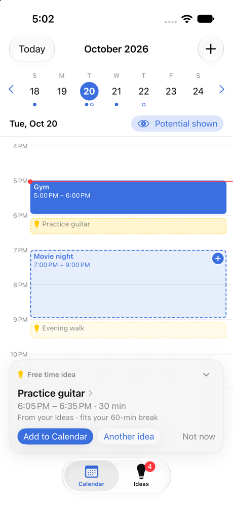

# Maybe Calendar

A personal iOS calendar for keeping track of both the plans you've committed to **and** the ones you might do. Tentative plans live on a separate "potential" layer you can show or hide, and a dateless **Ideas** list holds free-time activities until you're ready to put them on the calendar.

Built natively in Swift with SwiftUI.



## Building the app

**Requirements:** a Mac with **Xcode 27**. No third-party packages or extra setup are needed.

1. Clone the repository:
   ```bash
   git clone https://github.com/MayaKusumakar/Software-Design-Project.git
   cd Software-Design-Project
   ```
2. Open `MaybeCalendar.xcodeproj` in Xcode.
3. In the toolbar, pick the **MaybeCalendar** scheme and an iPhone simulator (for example **iPhone 17**).
4. Press **⌘R** (Product → Run). The app builds and launches in the simulator.

To run on a physical iPhone instead, select the **MaybeCalendar** target → **Signing & Capabilities**, choose your Apple ID team, and change the bundle identifier if Xcode asks.

Building from the command line also works:
```bash
xcodebuild -project MaybeCalendar.xcodeproj -scheme MaybeCalendar -destination 'platform=iOS Simulator,name=iPhone 17' build
```

### Optional: start with sample data
To see the app filled in right away, edit the scheme (**Product → Scheme → Edit Scheme… → Run → Arguments**) and add `-demoData` under *Arguments Passed On Launch*. This **replaces** any saved data with a few sample events, ideas, and past evening walks (so Smart Suggestions has some history to learn from). Remove the argument afterwards so your own data isn't overwritten on the next launch.

## Using the app

The app has two tabs: **Calendar** and **Ideas**.

### Try the core features in one minute
1. On the **Calendar** tab, tap an empty hour and save an event as **Confirmed**: it appears as a solid block.
2. Tap another hour, set the status to **Potential**, and save: it appears as a dashed, see-through block.
3. Tap the **Potential shown** button under the week strip to hide potential plans, then tap it again to bring them back.
4. Tap the **⊕** on the dashed block to commit to it: it turns solid.
5. Go to the **Ideas** tab, add an idea, and tap **Schedule**. Save it, and the app jumps back to the calendar with the idea placed as a potential plan.
6. Add another idea, then go back to the **Calendar** tab. A **Free time idea** card appears at the bottom of the day, suggesting it for a free gap. Tap **Add to Calendar**.

### Calendar tab
- **Pick a day** from the week strip at the top. Use the arrows (or swipe the strip) to change weeks, and **Today** to jump back.
  - A filled dot under a day means it has confirmed plans; a hollow dot means it has potential plans.
  - The day view opens at the current time for today, or at the first plan for other days.
- **Add an event:** tap **+** in the top-right, or tap any empty hour in the timeline to start an event at that time.
- **Edit or delete an event:** tap it. The editor lets you change the title, date, start/end time, status, and notes, and has a **Delete Event** button.
- **Confirmed vs. potential:** every event has a status.
  - **Confirmed** events are solid blue blocks.
  - **Potential** events are transparent with a dashed border.
- **Commit to a potential plan:** tap the **⊕** button on its block. It becomes confirmed immediately.
- **Show / hide potential plans:** tap the eye button under the week strip (**Potential shown** / **Potential hidden**). While hidden, it shows how many potential plans are hidden on that day. The setting is remembered.
- Overlapping events are placed side by side so you can compare options for the same time slot. The editor also warns you when a plan overlaps another one.

### Smart Suggestions
When a day has free time, the calendar suggests something from your own ideas (or something you often plan) that fits it.
- A **Free time idea** card sits at the bottom of the day view: the activity, its time and length, and a short reason such as *From your Ideas · fits your 60-min break* or *You often plan this in the evening*.
- The suggested time is marked on the timeline with a faint yellow outline. If two gaps have suggestions, tap the other outline to switch the card to it.
- **Add to Calendar** opens the event editor with everything filled in as a potential plan. Change anything you like, then tap **Save**.
- **Another idea** shows a different activity for the same free time.
- **Not now** hides that activity for a day. If you keep saying not now, it waits longer (3 days, then a week).
- Tap the activity's name to open the saved idea. Tap the **⌄** to shrink the card to a small button.

How it picks:
- **Only real free time.** It looks between 8 AM and 10 PM, skips time that has passed, and counts potential plans as busy. Gaps shorter than 30 minutes are ignored, and 5 minutes are left free before and after other plans.
- **Only what fits.** An activity is never suggested for a gap it doesn't fit in. Ideas with no length are treated as about an hour.
- **Your ideas first.** Saved ideas rank above anything learned from history. Ideas you've accepted before, ideas that match your usual times, and ideas that have waited a few weeks get a small boost. Ideas already on that day's calendar are skipped.
- **Careful with history.** Something counts as a habit only if you planned it on at least 3 different days in the last 2 months, and only if it was clearly free time: scheduled from an idea or suggestion, or saved as potential. Classes, meetings, work and appointments are never suggested.
- **Not overwhelming.** At most two gaps a day get a suggestion, each with a different activity. Similar ideas take turns from day to day.
- If there is nothing to suggest from yet, the card invites you to save an idea instead.

### Ideas tab
- **Add an idea:** type an activity (e.g. "Try the new ramen place") and tap **Add**. Ideas have no date.
- **Edit an idea:** tap it to set roughly how long it takes, the best time of day (morning, afternoon or evening), and whether you do it regularly. All of these are optional and help Smart Suggestions find the right free time.
- **Schedule an idea:** tap **Schedule**. The event editor opens with the title filled in and the status set to **Potential**. The time is set to the first free time on the selected day where the idea fits. Adjust it if you like and tap **Save**, and the app switches to the Calendar tab and scrolls to the new plan.
  - By default the idea is removed from the list once scheduled. Turn on **Keep in my ideas list** for things you do repeatedly; the app remembers this for next time.
- **Remove an idea:** swipe left on it and tap **Delete**.

### Saving
Everything is saved automatically on the device (a JSON file in the app's Documents folder), so your plans are still there after you close and reopen the app. This includes what you accepted or dismissed from Smart Suggestions. Nothing is sent anywhere; suggestions are worked out on the phone.

## Running the tests
In Xcode, press **⌘U** (Product → Test). The tests cover free-time detection (overlaps, buffers, events past midnight, daylight-saving days), ranking, cooldowns, learning from history, and loading data saved by older versions. From the command line:
```bash
xcodebuild test -project MaybeCalendar.xcodeproj -scheme MaybeCalendar -destination 'platform=iOS Simulator,name=iPhone 17'
```

## Project structure

| File | What it does |
| --- | --- |
| `MaybeCalendar/MaybeCalendarApp.swift` | App entry point and the two-tab layout |
| `MaybeCalendar/Store.swift` | Data models (`PlanEvent`, `Idea`) and saving/loading |
| `MaybeCalendar/CalendarView.swift` | Week strip, day timeline, event blocks, overlap layout |
| `MaybeCalendar/EventEditorView.swift` | Add / edit / delete / schedule-idea form |
| `MaybeCalendar/IdeasView.swift` | Ideas list |
| `MaybeCalendar/IdeaEditorView.swift` | View / edit one idea (length, best time, regular) |
| `MaybeCalendar/Suggestions.swift` | Smart Suggestions engine: free-time detection, habits, ranking |
| `MaybeCalendar/SuggestionViews.swift` | Suggestion card, timeline outline, and the "save an idea" invite |
| `MaybeCalendarTests/` | Unit tests for the engine and saving |

## Not included (by design)
Shared calendars, invitations, other integrated services, multiple accounts, tasks/to-dos, and recurring events are left out to keep the focus on personal scheduling and tentative plans.

## Other coursework
- [Homework 1 – App proposal](Homework1/HW1.md)
